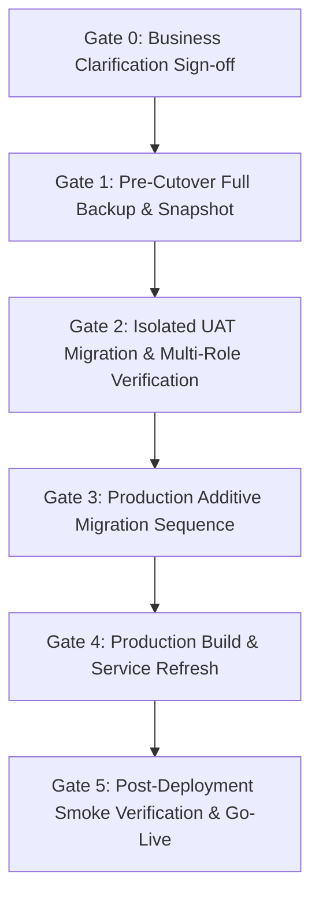
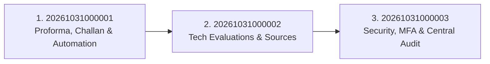

# ICON TECH PRO ERP V9.2 — CONSOLIDATED ENTERPRISE RELEASE PLAN

**Document Version:** 1.0.0  
**Release Plan Date:** 2026-11-05  
**Release Target:** ICON TECH PRO ERP V9.2 Production Release  
**Target Environment:** `https://erp.icontechpro.in`  
**Repository:** `C:\ICON-TECH-PRO-ERP`  
**Baseline Git Commit:** `6bc3635a2f19bf146d16c85fbedcd0fd82438dd1`  
**Release Strategy:** ONE Single Coordinated Release (Zero Fragmented Mini-Releases)  
**Execution Boundary:** Planning and Specification Phase. No production changes authorised or performed.

---

## 1. RELEASE OBJECTIVES & GOVERNANCE

### 1.1 Core Release Objective
Consolidate all completed V9.2 capabilities—including Customer Source tracking, Site Visit Project Categories, Optional Technical Evaluations, Enterprise Security (MFA, Progressive Lockout, 15-minute Password Recovery), SHA-256 Central Audit Ledger, Proforma Invoices, Delivery Challans, Two-Copy Printing, and 6 Automated Report Schedules—into **ONE unified enterprise release** deployed cleanly to `https://erp.icontechpro.in`.

### 1.2 Non-Negotiable Release Invariants
1. **Single Domain Policy:** Strictly `https://erp.icontechpro.in`. Zero alternate ports (no Port 3001), zero temporary Cloudflare tunnels, zero duplicate demo applications.
2. **Data Preservation:** Zero disruption, overwriting, or deletion of existing customer records, quotations, tax invoices, or user accounts.
3. **Additive-Only Migrations:** All database changes must execute through backwards-compatible additive DDL with pre-tested rollback scripts.
4. **TallyPrime Hold Invariant:** TallyPrime accounting integration remains strictly **ON HOLD** pending final specifications from the Accounts team.
5. **No Blind Deployments:** Every stage must satisfy verifiable quality gates before proceeding to production cutover.

---

## 2. PRE-DEPLOYMENT GATES & DEPENDENCY WORKSTREAM



### Gate 0: Business Clarification Sign-off
- **Mandate:** Secure executive decisions on the consolidated business questions documented in `ICON_TECH_PRO_ERP_V9_2_REQUIRED_DECISIONS_AND_CLARIFICATIONS.md`:
  1. Live email dispatch provider selection (Zoho vs. Google Workspace vs. SMTP).
  2. Scheduled report recipient email aliases (Daily, Weekly, Monthly, Quarterly, Bi-Annual, Annual).
  3. MFA enforcement rollout policy (Immediate for MD/Admin/Accounts; 14-day grace period for field staff).
- **Exit Criteria:** Written executive approval of recommended defaults.

### Gate 1: Pre-Cutover Full Backup & Snapshot Drill
- **Mandate:** Create an immutable recovery baseline prior to touching any production service.
- **Codebase Snapshot:** Tag the exact release state in Git:
  ```bash
  git tag -a v9.2.0-rc-production -m "ICON TECH PRO ERP V9.2 Consolidated Production Release Candidate"
  ```
- **Database Logical Backup:** Execute a full logical dump (`pg_dump`) of the production Supabase database (`xogynsnfzsvimwtvvhpx`):
  ```bash
  pg_dump -h db.xogynsnfzsvimwtvvhpx.supabase.co -U postgres -d postgres -F c -b -v -f "backups/prod_backup_pre_v9_2_$(date +%Y%m%d_%H%M%S).dump"
  ```
- **Exit Criteria:** Backup file verified for size, checksum recorded, and stored in secure offline storage.

### Gate 2: Isolated UAT Migration & Multi-Role Verification
- **Mandate:** Apply additive migrations to the authorized non-production UAT database (`njylssodwvaonbeebvjq`) and verify end-to-end behavior across all 5 user roles.
- **Role Verification Matrix:**
  1. *Managing Director (MD):* Full access to executive reports, quotation discount approvals, company-wide audit ledger, user lockout controls.
  2. *Accounts:* Access to Proforma Invoices, Tax Invoices, Delivery Challans, Receivables reports, payment receipts. Zero access to employee security logs.
  3. *Admin / BDM:* Lead management, territory assignment, enquiry follow-ups. Quarantined from company-wide audit and supplier purchase costs.
  4. *Salesperson / Engineer:* Quotation workspace (Before/Including GST), ad-hoc product insertion, site visit logs, technical evaluation BoM. Quarantined from supplier costs.
  5. *Office Assistant:* Read-only or basic operational tasks. Strict block on financial, audit, and security settings.
- **Exit Criteria:** 100% of role-based checks pass in isolated UAT with zero permission leaks.

---

## 3. DATABASE MIGRATION EXECUTION SEQUENCE

The three additive migrations must be executed strictly in chronological sequence. Each migration is idempotent (`IF NOT EXISTS`) and additive:



### Migration 1: `20261031000001_v9_2_enterprise_proforma_challan_and_automation.sql`
- **Objects Created:**
  - `proforma_invoices`, `proforma_invoice_items` (advance billing without ledger posting)
  - `delivery_challans`, `delivery_challan_items` (Rule 55 CGST dispatch documentation)
  - `signed_documents` (scanned acknowledgement archive)
  - `scheduled_reports`, `scheduled_report_logs` (6 automated briefings)
  - `email_outbox`, `email_dispatch_logs` (durable queuing with exponential backoff)
- **RLS & Permissions:** Row Level Security enabled; authenticated access rules applied.
- **Rollback Script:** `20261031000001_v9_2_enterprise_proforma_challan_and_automation_rollback.sql`

### Migration 2: `20261031000002_v9_2_technical_evaluations_and_sources.sql`
- **Objects Created / Modified:**
  - `technical_evaluations`, `technical_evaluation_items` (Sections A through H)
  - `site_visits` table extensions: `contact_person`, `contact_phone`, `assigned_technician_id`, `project_category`, `other_project_description`, `observations`, `follow_up_required`, `photos`
  - Enquiry source validation rules (7 canonical sources with legacy tolerance)
- **Rollback Script:** `20261031000002_v9_2_technical_evaluations_and_sources_rollback.sql`

### Migration 3: `20261031000003_v9_2_enterprise_security_and_audit.sql`
- **Objects Created:**
  - `account_lockouts` (3-attempt progressive lockout ladder)
  - `user_mfa_credentials` (RFC 6238 TOTP encrypted secrets, 8 PBKDF2 hashed backup codes)
  - `password_recovery_tokens` (15-minute single-use ephemeral tokens)
  - `enterprise_audit_ledger` (SHA-256 hash chained audit log)
  - `audit_checkpoints` (signed audit verification points)
  - Trigger `trg_audit_ledger_immutable` preventing UPDATE or DELETE
- **Rollback Script:** `20261031000003_v9_2_enterprise_security_and_audit_rollback.sql`

---

## 4. PRODUCTION BUILD, DEPLOYMENT & CUTOVER PROCEDURE

### 4.1 Deployment Strategy: Zero Unplanned Downtime
The production service runs on Port 3000 behind Cloudflare. The Next.js production build (`.next`) compiles standalone assets before swapping the runtime process, ensuring sub-second transition.

### 4.2 Step-by-Step Cutover Protocol
1. **Pre-Cutover Notification:** Notify all internal stakeholders of a 15-minute maintenance window outside peak business hours (recommended: 21:00 to 21:15 Asia/Kolkata).
2. **Environment Variable Binding:** Ensure `.env.production` contains all verified production secrets (Supabase credentials, session secrets, Zoho/Google OAuth tokens, `ENABLE_LIVE_EMAIL_DISPATCH=true`).
3. **Database Migration Execution:** Execute Migrations 1, 2, and 3 against the production database (`xogynsnfzsvimwtvvhpx`) via the authorized Supabase CLI or management interface.
4. **Production Build:**
   ```bash
   npm.cmd run build
   ```
   Confirm all 81 routes compile cleanly.
5. **Atomic Service Refresh:**
   Restart the production process under PM2 / Windows Service:
   ```bash
   pm2 reload icon-tech-pro-erp --update-env
   ```
6. **Edge Cache Purge:** Trigger Cloudflare cache purge for static assets to ensure browsers receive updated JavaScript bundles.

---

## 5. POST-DEPLOYMENT VERIFICATION & SMOKE TESTING

Immediately following service refresh, execute the post-cutover verification checklist:
1. **Public & Legal Routes:**
   - Verify `https://erp.icontechpro.in/` renders cleanly.
   - Verify `/about`, `/privacy-policy`, and `/terms-of-service`.
2. **Authentication & Session:**
   - Test login with authorized test administrator.
   - Verify session cookie flags (`HttpOnly`, `Secure`, `SameSite=Lax`).
   - Test progressive lockout on 3 consecutive invalid attempts.
   - Verify MFA challenge prompt for enrolled accounts.
3. **Workspaces & Forms:**
   - Load `/dashboard/customers` and Customer 360 view.
   - Verify 7 canonical enquiry sources in New Enquiry modal.
   - Open `/dashboard/quotations/new` and verify dual pricing modes (Before/Including GST) and fast product entry.
   - Create and print a draft Proforma Invoice (verify zero ledger entry).
   - Create and print a Delivery Challan (verify Rule 55 compliance).
4. **Audit Ledger Verification:**
   - Confirm login event, quotation draft, and test actions are recorded in `/dashboard/settings/audit`.
   - Verify SHA-256 hash chaining is intact and verified.
5. **Scheduled Reports Queue:**
   - Confirm the 6 report schedules are active with next run time set to `00:00 Asia/Kolkata`.

---

## 6. ROLLBACK & DISASTER RECOVERY PROTOCOL

### 6.1 Rollback Decision Triggers
An immediate rollback must be initiated if any of the following occur during cutover or smoke testing:
- **Trigger A (Database Failure):** Any additive migration fails to apply or corrupts preexisting tables.
- **Trigger B (Auth Breakdown):** Authenticated users are unable to log in, or sessions terminate unexpectedly.
- **Trigger C (Data Leakage):** Supplier purchase costs or internal remarks become visible in customer quotations.
- **Trigger D (Build/Runtime Crash):** HTTP 500 Internal Server Errors exceed 1% of total traffic.

### 6.2 Rollback Execution Steps
1. **Revert Application Build:**
   Switch to the previous known good Git tag:
   ```bash
   git checkout V9.2-FINAL
   npm.cmd run build
   pm2 reload icon-tech-pro-erp
   ```
2. **Revert Additive Database Migrations:**
   Execute rollback scripts in reverse order:
   ```bash
   # Step 1: Revert Security and Audit
   psql -f supabase/migrations/20261031000003_v9_2_enterprise_security_and_audit_rollback.sql
   # Step 2: Revert Technical Evaluations and Sources
   psql -f supabase/migrations/20261031000002_v9_2_technical_evaluations_and_sources_rollback.sql
   # Step 3: Revert Proforma, Challan and Automation
   psql -f supabase/migrations/20261031000001_v9_2_enterprise_proforma_challan_and_automation_rollback.sql
   ```
3. **Database Full Restoration (Emergency Fallback):**
   If database inconsistency occurs, restore from the pre-cutover dump:
   ```bash
   pg_restore -h db.xogynsnfzsvimwtvvhpx.supabase.co -U postgres -d postgres -c -v "backups/prod_backup_pre_v9_2.dump"
   ```
4. **Post-Rollback Verification:** Verify that baseline V9.2 functionality is restored and report the incident.

---

*Plan prepared strictly in accordance with ICON TECH PRO ERP Enterprise Engineering Standards.*
