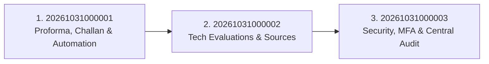

# ICON TECH PRO ERP V9.2 — DATABASE MIGRATION & ROLLBACK PLAN

**Document Version:** 1.0.0  
**Date:** 2026-11-05  
**Project:** ICON TECH PRO ERP  
**Repository:** `C:\ICON-TECH-PRO-ERP`  
**Official Production URL:** `https://erp.icontechpro.in`  
**Target Database (Production):** Supabase ref `xogynsnfzsvimwtvvhpx` (UNTOUCHED)  
**Target Database (UAT):** Supabase ref `njylssodwvaonbeebvjq` (Non-Production Staging)  
**Baseline Commit:** `6bc3635a2f19bf146d16c85fbedcd0fd82438dd1`  
**Git Tag:** `V9.2-FINAL`  
**Migration Strategy:** Strictly Additive, Idempotent, Backwards-Compatible DDL with Matched Rollbacks

---

## 1. MIGRATION GOVERNANCE & SAFETY MANDATE

All database modifications for ICON TECH PRO ERP V9.2 adhere to strict enterprise principles:
1. **Zero Destructive Changes:** No preexisting tables are dropped, renamed, or truncated. No preexisting columns are modified or deleted.
2. **Strictly Additive Design:** All new features use new dedicated tables or optional nullable columns on existing tables with safe defaults.
3. **Idempotency Guarantee:** Every `CREATE TABLE`, `CREATE INDEX`, and `ALTER TABLE` statement uses `IF NOT EXISTS` guards.
4. **Matched Rollbacks:** Every additive migration file has an exact reverse rollback script (`..._rollback.sql`) that drops newly created objects without disturbing baseline data.
5. **Production Safety Boundary:** In accordance with project instructions, **zero migrations were run against production** during this phase. Remote production migration status is safely classified as **UNKNOWN / PENDING AUTHORIZED MIGRATION**.

---

## 2. CHRONOLOGICAL MIGRATION INVENTORY (49 BASELINE + 3 V9.2 ADDITIVE)

### 2.1 Baseline Migrations (1 to 46) — Foundation to Production Hardening
- `20260910000001_initial_foundation.sql`: Core users, roles, organizations, sequence numbering.
- `20260911000002_customer_master.sql`: Customer accounts, contacts, addresses, GSTIN fields.
- `20260911000003_complete_erp_suite.sql`: Quotations, line items, sales orders, purchase orders, invoices.
- `20260911000004_rls_and_sequences.sql`: Row Level Security policies and sequence generators.
- `20260912000001_admin_users_and_permissions.sql`: Admin centre roles, managed credentials.
- `20260912000002_reseller_priority1_foundation.sql` to `20260914000007_reseller_day7_hr_and_demo.sql`: Reseller workflows, product library, day 1–7 operational tables.
- `20260919000008_v8_master_core.sql` to `20260919000022_v8_executive_reporting.sql`: V8 intelligence tables, serial ledgers, AMC, voice telephony, BI reporting.
- `20260922000001_v9_1_master_admin_rbac.sql` to `20260928000002_document_center_amc_and_notifications.sql`: Master RBAC, company settings, Gmail/Zoho sync, document center.
- `20260929000001_reseller_day1_core_recovery.sql` to `20261029000001_production_security_hardening.sql`: UAT user profiles, spec intelligence records, product intelligence library, Zoho organization mail tables, Gate C least privilege remediation, and production security hardening.

### 2.2 Additive V9.2 Enterprise Migrations (47 to 49)
The three consolidated V9.2 migrations provide the complete database schema for all newly implemented enterprise modules:



---

## 3. DEEP TECHNICAL ANALYSIS OF ADDITIVE V9.2 MIGRATIONS

### Migration 1: `20261031000001_v9_2_enterprise_proforma_challan_and_automation.sql`
- **File Length:** 21,348 bytes
- **Objects Created:**
  - `proforma_invoices`: Advance commercial billing records (`id`, `proforma_number`, `quotation_id`, `customer_id`, `subtotal`, `cgst_amount`, `sgst_amount`, `igst_amount`, `total_amount`, `status`, `terms_conditions`, `created_at`, `created_by`).
  - `proforma_invoice_items`: Line items for proforma invoices with HSN/SAC, unit prices, and GST rates.
  - `delivery_challans`: Rule 55 CGST dispatch records (`id`, `challan_number`, `order_id`, `customer_id`, `transporter_name`, `vehicle_number`, `eway_bill_number`, `dispatch_date`, `status`, `created_at`).
  - `delivery_challan_items`: Itemized material dispatch with serial number and MAC address arrays.
  - `signed_documents`: Physical signed delivery challans and customer acknowledgements.
  - `scheduled_reports`: Master schedule definitions for the 6 executive briefing cadences.
  - `scheduled_report_logs`: Execution history, recipient resolution logs, and idempotency keys.
  - `email_outbox` & `email_dispatch_logs`: Durable queuing with retry backoff and correlation IDs.
- **RLS & Database Grants:** RLS enabled on all 8 tables; authenticated read/write grants isolated by role.
- **Rollback Script:** `20261031000001_v9_2_enterprise_proforma_challan_and_automation_rollback.sql` (1,374 bytes). Drops created tables cleanly via `DROP TABLE IF EXISTS ... CASCADE`.

### Migration 2: `20261031000002_v9_2_technical_evaluations_and_sources.sql`
- **File Length:** 9,847 bytes
- **Objects Created / Modified:**
  - `technical_evaluations`: Comprehensive pre-sales engineering evaluations covering Sections A through H (`id`, `site_visit_id`, `customer_id`, `lead_engineer_id`, `project_category`, `sections_json`, `recommendations_json`, `status`, `created_at`).
  - `technical_evaluation_items`: Sizing Bill of Materials with engineering specifications and quarantined internal supplier purchase costs.
  - `site_visits` table extensions: Additive nullable columns: `contact_person`, `contact_phone`, `assigned_technician_id`, `project_category`, `other_project_description`, `observations`, `follow_up_required`, `photos`.
  - Customer enquiry sources constraint: Enforces the 7 canonical sources while preserving legacy values.
- **Rollback Script:** `20261031000002_v9_2_technical_evaluations_and_sources_rollback.sql` (1,967 bytes). Drops evaluation tables and safely alters `site_visits` columns.

### Migration 3: `20261031000003_v9_2_enterprise_security_and_audit.sql`
- **File Length:** 8,003 bytes
- **Objects Created:**
  - `account_lockouts`: Progressive lockout tracking (`user_id`, `email`, `failed_attempts`, `is_locked`, `locked_until`, `lockout_count_24h`, `last_failed_at`).
  - `user_mfa_credentials`: Multi-Factor Authentication credentials (`user_id`, `email`, `mfa_enabled`, `mfa_secret_encrypted`, `mfa_enrolled_at`, `backup_codes_hashes`, `mfa_grace_period_ends_at`).
  - `password_recovery_tokens`: Ephemeral 15-minute single-use recovery tokens (`token_hash`, `user_id`, `expires_at`, `is_used`).
  - `enterprise_audit_ledger`: SHA-256 chained audit records (`event_id`, `timestamp`, `employee_id`, `user_name`, `role`, `category`, `severity`, `module`, `action`, `record_type`, `record_id`, `before_state`, `after_state`, `diff`, `previous_hash`, `entry_hash`, `retention_category`, `legal_hold`).
  - `audit_checkpoints`: Signed cryptographic checkpoints.
  - Trigger `trg_audit_ledger_immutable`: Calls function `fn_block_audit_mutation()` to raise an exception on UPDATE or DELETE.
- **Rollback Script:** `20261031000003_v9_2_enterprise_security_and_audit_rollback.sql` (1,456 bytes). Drops immutability trigger, function, and security tables.

---

## 4. SINGLE ORDERED PRODUCTION MIGRATION PACKAGE

When management authorizes production cutover, the migrations must be applied in the following single atomic transaction or strictly ordered sequence:

```sql
-- ==============================================================================
-- ICON TECH PRO ERP V9.2 CONSOLIDATED PRODUCTION MIGRATION RUNNER
-- Sequence: 1 -> 2 -> 3
-- Pre-requisite: Full pg_dump logical backup completed
-- ==============================================================================

BEGIN;

-- 1. Apply Enterprise Proforma, Delivery Challan & Automation
\i supabase/migrations/20261031000001_v9_2_enterprise_proforma_challan_and_automation.sql

-- 2. Apply Technical Evaluations, Site Visit Categories & Customer Sources
\i supabase/migrations/20261031000002_v9_2_technical_evaluations_and_sources.sql

-- 3. Apply Enterprise Security, MFA, Progressive Lockout & SHA-256 Central Audit
\i supabase/migrations/20261031000003_v9_2_enterprise_security_and_audit.sql

COMMIT;
```

---

## 5. VERIFIED ROLLBACK & EMERGENCY RESTORATION PLAN

### 5.1 Additive Rollback Protocol
If any issue is detected immediately following migration execution, the rollbacks must be executed in reverse order:
```bash
# Step 1: Rollback Security and Audit
psql -f supabase/migrations/20261031000003_v9_2_enterprise_security_and_audit_rollback.sql

# Step 2: Rollback Technical Evaluations and Sources
psql -f supabase/migrations/20261031000002_v9_2_technical_evaluations_and_sources_rollback.sql

# Step 3: Rollback Proforma, Challan and Automation
psql -f supabase/migrations/20261031000001_v9_2_enterprise_proforma_challan_and_automation_rollback.sql
```

### 5.2 Emergency Full Database Restoration Drill
In the catastrophic event of unrecoverable database corruption, restore from the verified pre-cutover logical snapshot:
```bash
pg_restore -h db.xogynsnfzsvimwtvvhpx.supabase.co -U postgres -d postgres -c -v "backups/prod_backup_pre_v9_2.dump"
```

---

*Plan prepared strictly in accordance with ICON TECH PRO ERP Enterprise Engineering Standards.*
