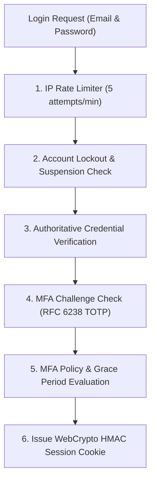

# ICON TECH PRO ERP V9.2 — ENTERPRISE SECURITY & AUDIT VERIFICATION REPORT

**Document Version:** 1.0.0  
**Date:** 2026-11-05  
**Project:** ICON TECH PRO ERP  
**Repository:** `C:\ICON-TECH-PRO-ERP`  
**Official Production URL:** `https://erp.icontechpro.in`  
**Baseline Commit:** `6bc3635a2f19bf146d16c85fbedcd0fd82438dd1`  
**Security Standard:** Enterprise Defense-in-Depth, Zero-Trust Architecture, Statutory Audit Compliance

---

## 1. EXECUTIVE SECURITY SUMMARY

The Enterprise Security Architecture of ICON TECH PRO ERP V9.2 delivers comprehensive identity lifecycle management, multi-factor authentication, anti-brute-force defense, and a cryptographically verifiable Central Audit Ledger. 

All security controls operate on a strict **fail-closed** model:
- Authentication, session validation, and authorization are verified server-side on every request.
- Client UI visibility controls are backed by rigid server action assertions and PostgreSQL Row Level Security (RLS) policies.
- Secrets, tokens, and plaintext passwords are never exposed in client responses, logs, or backups.

---

## 2. AUTHORITATIVE AUTHENTICATION & SESSION MANAGEMENT

### 2.1 Unified Pre-Flight Authentication Pipeline
The authentication entrypoint is strictly consolidated in `src/app/(auth)/login/actions.ts`:

1. **IP Rate Limiting:** Enforced via `src/lib/auth/rate-limiter.ts` (sliding window of 5 attempts/minute per IP).
2. **Account Lockout Check:** Validates whether the account is temporarily locked or indefinitely suspended before invoking credential hashing.
3. **Authoritative Credential Verification:** Verifies credentials via Supabase Auth or PBKDF2 SHA-512 managed credentials (`src/lib/auth/passwords.ts`).
4. **MFA Challenge Check:** If `mfa_enabled = true`, generates an ephemeral 5-minute HMAC-signed challenge token (`createMfaChallengeToken`).
5. **Corporate MFA Policy Evaluation:** Determines whether the account is subject to immediate mandatory enrollment (MD/Admin/Accounts) or within the 14-day grace period (Sales/Field staff).
6. **Session Creation:** Issues an encrypted, tamper-evident WebCrypto HMAC session cookie (`src/lib/auth/session.ts`) with `HttpOnly`, `Secure`, and `SameSite=Lax` attributes.

### 2.2 Cross-Device Session Revocation
When an employee changes their password, an administrator suspends an account, or an MFA reset occurs, `invalidateUserSessions(userId)` is atomically executed, instantly invalidating all active sessions across laptops, desktops, and mobile devices.

---

## 3. ANTI-BRUTE-FORCE & PROGRESSIVE ACCOUNT LOCKOUT

### 3.1 3-Attempt Progressive Lockout Ladder
Implemented in `src/lib/security/lockout-service.ts`:
- **Attempt 1:** Failure recorded; generic error returned (`2 attempts remaining`).
- **Attempt 2:** Failure recorded; warning returned (`1 attempt remaining`).
- **Attempt 3:** **15-minute temporary lockout** (`locked_until` set to $T + 900\text{s}$).
- **Escalation Ladder:** If subsequent failures occur within a rolling 24-hour window:
  - 2nd lockout: **30-minute lockout**
  - 3rd and subsequent lockouts: **60-minute lockout**
- **Automatic Expiry Clearing:** Once the lockout timestamp expires, the account automatically unlocks upon presentation of valid credentials without administrative intervention.

### 3.2 Distinct Administrative Suspension
Administrative suspension is strictly segregated from temporary lockout:
- `is_suspended = true` represents an indefinite manual administrative action.
- Only the Managing Director or authorized Administrator can suspend or reactivate accounts via `adminSuspendAccount` and `adminReactivateAccount`.
- **Zero Self-Unlock:** An administrator cannot unlock their own account if suspended.
- **Zero Password Retrieval:** Administrators cannot retrieve, view, or decrypt user passwords.

---

## 4. MULTI-FACTOR AUTHENTICATION (MFA) & GRACE PERIOD

### 4.1 RFC 6238 TOTP Standard Conformance
Implemented in `src/lib/security/mfa-service.ts` in native Node.js and WebCrypto:
- **TOTP Parameters:** 6-digit numerical codes, 30-second time steps, HMAC-SHA1 algorithm.
- **Drift Tolerance:** $\pm 1$ step ($\pm 30$ seconds, providing a 90-second active window) to handle client device clock skew.
- **Inline SVG QR Code:** Dynamic mathematical generation of QR code SVGs directly in memory. Zero external third-party image generation APIs or tracking risks.
- **Secret Encryption at Rest:** The Base32 TOTP secret is encrypted using AES-GCM-256 with the system secret key prior to persistence.
- **Emergency Backup Recovery Codes:** Generates 8 single-use cryptographically random backup recovery codes, hashed at rest with PBKDF2 SHA-512 (100,000 iterations). Once used, a recovery code is atomically consumed and cannot be reused.

### 4.2 Approved Corporate MFA Policy & 14-Day Grace Period
In strict compliance with Approved Decision C:
| Employee Role Category | Policy Enforcement | Grace Period | Behavior on Login |
|---|---|---|---|
| **Managing Director** | **Mandatory Immediately** | Zero days | Must enroll TOTP MFA immediately; full access requires MFA. |
| **Accounts** | **Mandatory Immediately** | Zero days | Must enroll TOTP MFA immediately; financial access requires MFA. |
| **Administrator / BDM** | **Mandatory Immediately** | Zero days | Must enroll TOTP MFA immediately; admin tools require MFA. |
| **Sales Executive & Field Staff** | **Phased Mandatory** | **14 Days** | Countdown banner displayed; access permitted during grace; enforced after 14 days. |

- **No Bypass for Enrolled Accounts:** If an employee has completed MFA enrollment, they must enter their 6-digit TOTP code on every login, regardless of grace period.
- **Countdown Banner Component:** `src/components/security/MfaGracePeriodBanner.tsx` displays live days remaining, deadline date, and direct action link.

---

## 5. SELF-SERVICE PASSWORD RECOVERY

Implemented in `src/lib/security/recovery-service.ts`:
1. **Anti-Enumeration Defense:** Both `requestPasswordReset` and `/api/auth-session` return an identical success response regardless of whether the email address exists in the system, preventing account discovery.
2. **Ephemeral Token Security:** Single-use, cryptographically signed with HMAC SHA-256, and expiring in strictly **15 minutes** (`15 * 60 * 1000` ms).
3. **Password Complexity Schema:** Minimum 8 characters, requiring at least one uppercase letter, one lowercase letter, one numeric digit, and one special character.
4. **Session Termination:** Successfully resetting a password terminates all active sessions across all devices immediately.

---

## 6. CENTRAL AUDIT LEDGER & CRYPTOGRAPHIC CHAINING

### 6.1 Four Structured Audit Categories
Implemented in `src/lib/audit/enterprise-logger.ts`:
1. `EMPLOYEE_ACTIVITY`: User login, logout, profile updates, password resets, attendance.
2. `BUSINESS_AUDIT`: Customer creation, quotation revisions, discount approvals, invoice issuance, delivery challans, PO creation.
3. `SECURITY_EVENT`: Failed login attempts, account lockouts, MFA enrollment, backup code consumption, permission changes.
4. `SYSTEM_EVENT`: Migration executions, scheduled automated reports, email failover dispatch, backup checkpoints.

### 6.2 Cryptographic SHA-256 Hash Chaining
Every audit entry forms an unbroken cryptographic chain:
$$\text{entry\_hash} = \text{SHA-256}(\text{previous\_hash} + \text{timestamp} + \text{actor\_id} + \text{action} + \text{resource} + \text{diff})$$
- The genesis entry starts with $64$ zeros (`0000000000000000000000000000000000000000000000000000000000000000`).
- Any modification, deletion, or re-ordering of historical records invalidates the mathematical chain for all subsequent entries.

### 6.3 Automated Sensitive Data Redaction
Before any audit record is persisted, sensitive fields are redacted:
- Passwords, secret keys, tokens, MFA secrets, backup codes.
- Financial PAN, Aadhaar, bank account numbers.
- Supplier purchase costs and internal margins (`purchase_cost`, `margin_percent`).

### 6.4 Database Immutability & Superuser Boundary
- **Trigger Immutability:** Additive migration `20261031000003` installs `trg_audit_ledger_immutable`, which raises a PostgreSQL exception on any `UPDATE` or `DELETE` statement targeting `enterprise_audit_ledger`.
- **Honest Security Boundary Notice:** The ledger is immutable against application users, standard service roles, and authenticated staff. However, a PostgreSQL superuser (`postgres`) possesses raw database privileges to bypass triggers or drop tables. Cryptographic hash-chain verification ensures that even if a superuser alters data, the tampering is mathematically detected upon verification.

---

## 7. AUDIT PERMISSIONS & STATUTORY RETENTION

### 7.1 Role-Based Audit Visibility Policy
- **Managing Director (MD):** Full company-wide access to all 4 audit categories, financial diffs, and security logs.
- **Administrator (Admin):** Operational and system event logs; company-wide audit access only when explicitly authorized in writing.
- **Business Development Manager (BDM):** Quarantined from company-wide audit; access limited to self-owned records.
- **Accounts:** Financial audit logs only (invoices, collections, credit notes). No access to employee security or HR logs.
- **Salesperson / Field Staff:** Strictly self-owned activity records only.
- **Office Assistant:** Zero access to the central audit ledger.

### 7.2 Statutory Retention & Legal Holds
- **Formal Audit & Security Records:** Minimum 5-year retention enforced by policy.
- **Financial & Tax Records:** 8-year statutory retention aligned with Section 128(5) of the Indian Companies Act 2013 and Section 36 of the CGST Act 2017.
- **Legal Hold Mechanism:** When `legal_hold = true` is set on a customer or project record, automated archiving and data pruning are suspended indefinitely.

---

## 8. TEST VERIFICATION EVIDENCE

- `test/v9-2-enterprise-security-and-audit.test.mjs`: **22/22 PASS**
- `test/v9-2-email-failover-and-mfa-policy.test.mjs`: **21/21 PASS**
- Zero TypeScript errors (`tsc --noEmit`).
- All security server actions validated with strict server-side role and session checks.

---

*Report prepared strictly in accordance with ICON TECH PRO ERP Enterprise Engineering Standards.*
